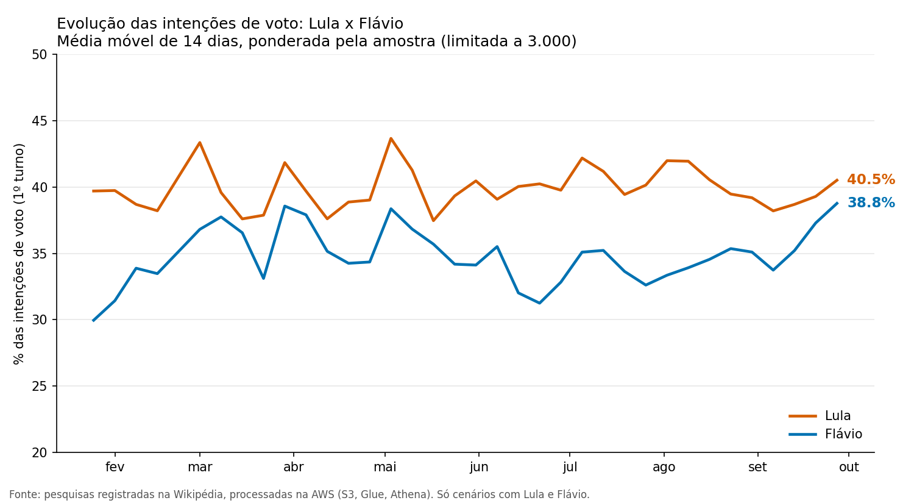
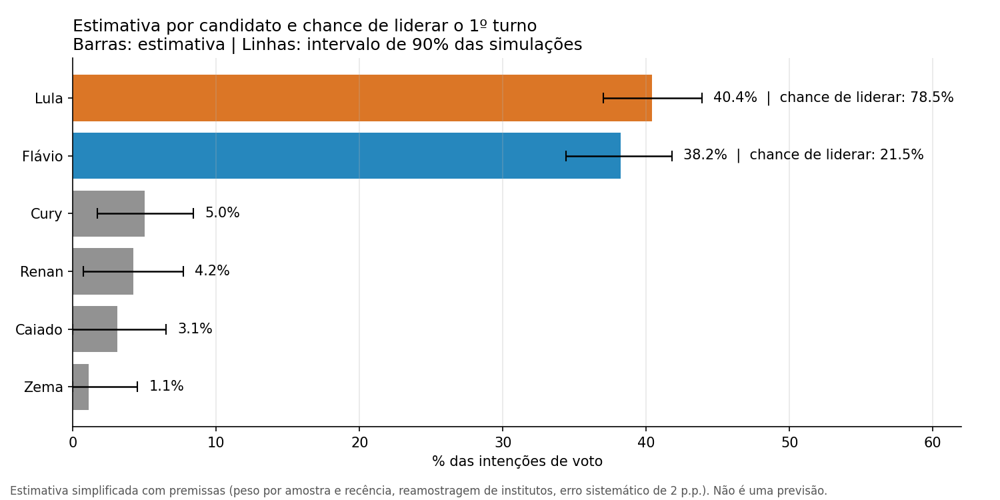
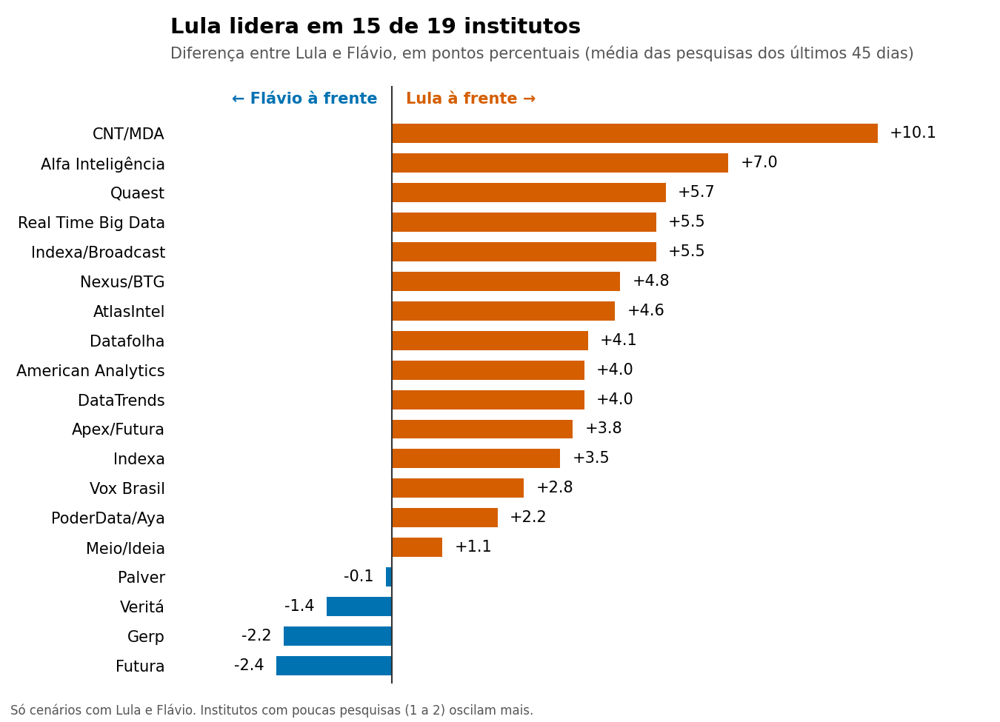
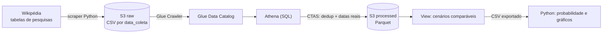

# Eleições 2026: popularidade e probabilidade a partir de pesquisas (pipeline na AWS)

Pipeline de dados em nuvem que coleta pesquisas eleitorais para a Presidência do Brasil em 2026, organiza os dados em camadas na AWS (S3, Glue, Athena) e estima, com SQL e Python, a **popularidade de cada candidato** e a **chance de liderar o 1º turno**.

> **Projeto de portfólio para estudo de engenharia e análise de dados.** As probabilidades são uma **estimativa simplificada, baseada em premissas declaradas abaixo, e não uma previsão eleitoral**.

**Stack:** Python (requests, BeautifulSoup, pandas, numpy, matplotlib) · SQL (Athena/Trino) · AWS (S3, IAM, Glue Crawler e Data Catalog, Athena) · Parquet

---

## Resultado (dados de 02/10/2026)

Simulação com 59 pesquisas de 19 institutos dos últimos 45 dias, apenas cenários com Lula e Flávio.

| Candidato | Estimativa | Intervalo de 90% | Chance de liderar o 1º turno |
|---|---|---|---|
| Lula | 40,4% | 37,0 a 43,9 | 78,5% |
| Flávio | 38,2% | 34,4 a 41,8 | 21,5% |
| Cury | 5,0% | 1,7 a 8,4 | ~0% |
| Renan | 4,2% | 0,7 a 7,7 | ~0% |
| Caiado | 3,1% | 0,0 a 6,5 | ~0% |
| Zema | 1,1% | 0,0 a 4,5 | ~0% |

Como a chance de liderar depende das premissas, rodei variações:

| Variação | Chance de Lula liderar |
|---|---|
| Erro sistemático de 1 ponto | 90% a 94% |
| **Erro sistemático de 2 pontos (padrão)** | **76% a 80%** |
| Erro sistemático de 3 pontos | 69% a 72% |
| Sem o limite de amostra por pesquisa | 60,7% |
| Janela de 30 / 45 / 90 dias | 75,5% / 78,5% / 80,2% |

A leitura honesta é que **a chance de liderar fica entre cerca de 70% e 90%, conforme a premissa**. As médias quase não mudam entre as variações (Lula entre 40,1% e 40,9%; Flávio entre 37,7% e 38,8%).







---

## Arquitetura



| Camada | Onde | O que contém |
|---|---|---|
| raw | `s3://<bucket>/raw/fonte=wikipedia/ano=2026/data_coleta=AAAA-MM-DD/` | CSV bruto de cada coleta (histórico preservado) |
| catálogo | Glue database `eleicoes2026`, tabela `raw_fonte_wikipedia` | Schema e partições (`ano`, `data_coleta`) |
| processed | `s3://<bucket>/processed/pesquisas/` | Parquet deduplicado, com `data_inicio` e `data_fim` reais |
| análise | Athena + Python | Médias, evolução semanal, probabilidades e gráficos |

---

## Decisões de método

1. **Só cenários com Lula e Flávio.** Uma pesquisa testa vários cenários, e misturá-los distorce a média de cada candidato. A view `vw_pesquisas_comparaveis` mantém os 231 cenários (de 282) em que os dois aparecem.
2. **Amostra limitada a 3.000 no peso.** Três pesquisas do Veritá, com 40.500 entrevistados cada, chegavam a **59% do peso total** e invertiam o ranking. Com o limite, o maior instituto fica em cerca de 12% do peso.
3. **Recência.** O peso cai pela metade a cada 14 dias, numa janela de 45 dias.
4. **Incerteza vem dos institutos.** A simulação reamostra **institutos** (20.000 rodadas) e soma um erro sistemático de 2 pontos, porque a diferença entre institutos (de 4 a 10 pontos entre Lula e Flávio) é maior que a margem de erro de cada pesquisa.
5. **"Chegar ao 2º turno"** é estar entre os dois mais votados, supondo que ninguém vença no 1º turno.

---

## Problemas de qualidade de dados encontrados e corrigidos

| Problema | Efeito | Correção |
|---|---|---|
| Coluna "Vantagem" da Wikipédia lida como candidato | Diferença entre 1º e 2º aparecia como candidato | Excluída das colunas de candidato |
| CSV com BOM (`utf-8-sig`) | Pode corromper o cabeçalho no Glue/Athena | Gravação em `utf-8` |
| Coluna `data_coleta` no CSV e partição de mesmo nome no S3 | Colunas duplicadas na tabela | Coluna renomeada para `timestamp_coleta` e trava no código |
| Partido "Democrata" fora do dicionário | Candidato sem partido | Adicionado ao dicionário |
| Travessão (–) entre as datas | Uma pesquisa ficou com início depois do fim | Padrão `[-–—]` no CTAS |
| Célula vazia de CSV lida como `''` e não `NULL` | `IS NULL` não encontrava partidos vazios | Checagem com `TRIM(partido) = ''` |
| 2º turno entrando na coleta | 2.046 registros fora do escopo | Chave `INCLUIR_SEGUNDO_TURNO` (desligada) |

---

## Estrutura do repositório

```
├── src/
│   ├── scraper/scraper_wikipedia.py   coleta, validação e envio ao S3
│   └── analise/
│       ├── probabilidade.py           pesos, simulação e probabilidades
│       └── graficos.py                gráficos do README
├── sql/                               consultas do Athena, na ordem de uso
├── data/sample/                       amostra dos dados já processados
├── graficos/                          imagens geradas
├── resultados/probabilidades.csv      saída do probabilidade.py
├── requirements.txt
└── .gitignore
```

---

## Como reproduzir

### Sem AWS (usa a amostra do repositório)

```bash
python -m pip install -r requirements.txt

# Windows
copy data\sample\pesquisas_comparaveis.csv dados_processados\
# macOS / Linux: cp data/sample/pesquisas_comparaveis.csv dados_processados/

python src/analise/probabilidade.py
python src/analise/graficos.py
```

Rode os comandos na raiz do repositório. Os resultados saem em `resultados/` e `graficos/`.

### Com AWS

1. Configure as credenciais com `aws configure`, usando um usuário IAM com permissão mínima (nunca a conta root) e **sem colocar chaves no código ou no repositório**.
2. Crie um bucket no S3 e ajuste `BUCKET` em `src/scraper/scraper_wikipedia.py`.
3. Rode o scraper (`python src/scraper/scraper_wikipedia.py`). Ele gera o CSV e envia para `raw/fonte=wikipedia/ano=2026/data_coleta=AAAA-MM-DD/`.
4. No Glue, crie o database `eleicoes2026` e um Crawler sobre `raw/fonte=wikipedia/`, com prefixo `raw_`.
5. No Athena, rode os arquivos de `sql/` na ordem. Em cada um, troque `SEU-BUCKET` pelo nome do seu bucket. O Athena executa um comando por vez.
6. Exporte o resultado de `sql/06_exportar_para_python.sql` para `dados_processados/pesquisas_comparaveis.csv` e rode os scripts de `src/analise/`.

Para novas coletas, `MSCK REPAIR TABLE` registra as partições sem rodar o Crawler de novo.

**Custo:** o projeto inteiro ficou na casa de poucos centavos de dólar (as execuções do Crawler custam cerca de US$ 0,15 cada; Athena e S3 ficam em frações de centavo para este volume).

---

## Limitações

- A Wikipédia é uma **fonte secundária**: consolida pesquisas publicadas por terceiros, e erros de transcrição são possíveis.
- As médias misturam institutos com **efeito de instituto** (diferença sistemática entre eles), que a simulação trata, mas não elimina.
- A probabilidade vem de **premissas** (peso, meia-vida, erro sistemático) e não foi validada contra resultados passados.
- Só **1º turno**: a probabilidade se refere a liderar ou chegar ao 2º turno, e não a "ser eleito".
- A lista de candidatos inclui nomes testados em cenários hipotéticos.
- Pesquisas muito recentes podem ainda não estar na Wikipédia no momento da coleta.
- O erro sistemático é aplicado de forma independente a cada candidato, sem modelar a correlação entre eles.

---

## Próximos passos

- Recorte regional (SP, MG e RJ) com os números estaduais divulgados pelos institutos.
- Cruzamento com os dados de registro de pesquisas do TSE (validação e peso de confiabilidade).
- Comparação **previsão x resultado oficial** depois do 1º turno.
- Coleta automática com EventBridge + Lambda, transformação em Glue Job e infraestrutura como código (Terraform).
- Dashboard (QuickSight) e simulação de 2º turno.

---

## Fontes e licença

- Pesquisas: tabelas da Wikipédia em português (*Pesquisas de opinião para a eleição presidencial no Brasil em 2026*), sob licença CC BY-SA 4.0. Os dados em `data/sample/` derivam dessa fonte.
- Autor: `<seu nome>` · [LinkedIn](https://www.linkedin.com/) · [GitHub](https://github.com/)
